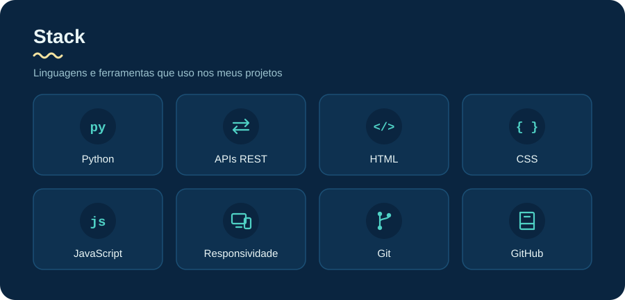
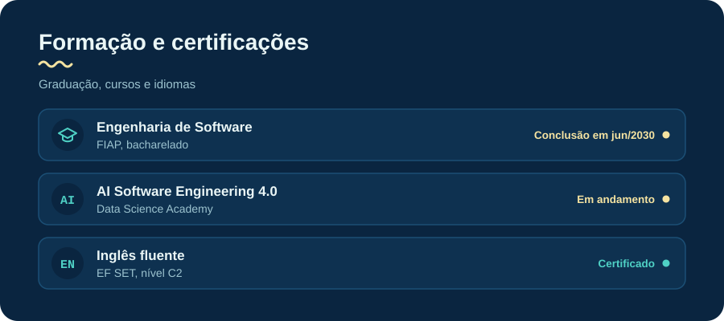
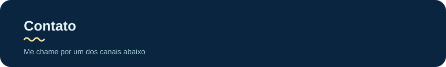

<!--
  Cada seção visual é um arquivo .svg na pasta /assets.
  Para mudar o texto de uma seção, edite o .svg dela (há instruções no topo de cada arquivo).
  Para mudar links de contato, edite os href aqui embaixo.
-->

  

 

  

 

  

 

  

<!-- CONTATO: troque o e-mail e o número (formato wa.me/55 + DDD + número, só dígitos) -->

  
  

